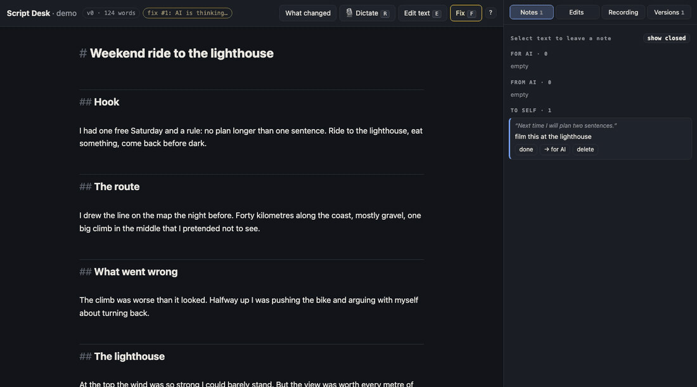
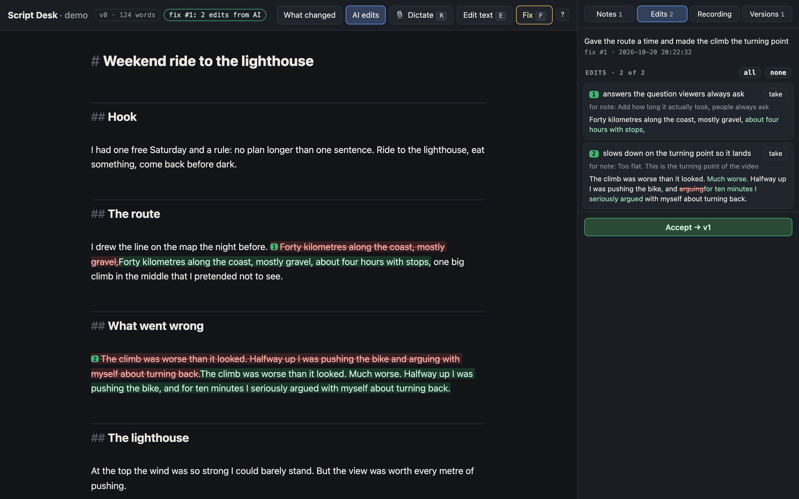
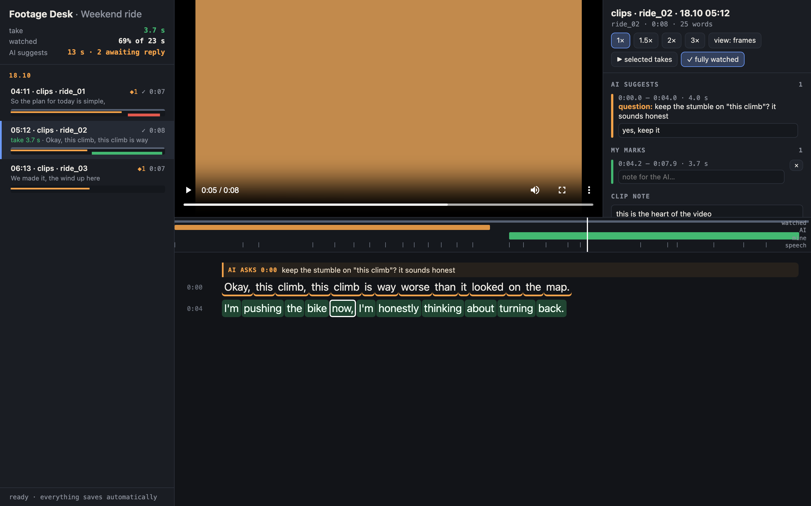

# Agent Video Desk

**Co-edit video scripts and pick footage by transcript with your AI agent — in a real UI, not a chat log.**

Agent skills and a plugin for **Claude Code** and **OpenAI Codex** (and any agent that runs shell commands). You work in a local browser page; your agent works through a small CLI. Both sides write to their own files in the project folder, so neither one overwrites the other, and you stay in control of every change.

[](https://github.com/c0t0ber/agent-video-desk/actions/workflows/ci.yml)
[](LICENSE)




| Skill | What it does |
|---|---|
| **[Script Desk](skills/script-desk/SKILL.md)** | Leave notes on your script, press **Fix**, and your agent proposes concrete edits. You take or skip each one, and every accepted round becomes a version snapshot. |
| **[Footage Desk](skills/footage-desk/SKILL.md)** | Watch clips next to their word-level transcript, mark **take** / **skip** right on the words, and let the agent pick the rest and turn it into a cut list. A paper edit you share with your agent. |
| **[ru-transcribe](skills/ru-transcribe/SKILL.md)** | Verbatim Russian speech-to-text with per-word timestamps (GigaAM-v3 + WhisperX). It keeps the retakes and false starts that Whisper smooths away, which is what you need for cutting. |





## Why

Reviewing a 2,000-word script or an hour of footage through chat doesn't work well. You can't point at a sentence, the agent rewrites things you didn't ask about, and nobody remembers which version was approved. These desks give you and the agent one shared surface:

- **You point, the agent edits.** Notes are pinned to exact spans of text or exact words in a clip.
- **Nothing changes without you.** Agent edits arrive as proposals; you take or skip each one.
- **Every round is saved.** Script versions are immutable snapshots (`v0.md`, `v1.md`, …); footage marks survive rebuilds.
- **It all runs locally.** A Python standard-library server on `127.0.0.1`. No accounts and no cloud, and your footage never leaves your machine.

Built for a real YouTube workflow: the agent drafts and cuts, the human decides.

## Install

**Claude Code**

```
/plugin marketplace add c0t0ber/agent-video-desk
/plugin install agent-video-desk@agent-video-desk
```

**OpenAI Codex**

```bash
codex plugin marketplace add c0t0ber/agent-video-desk
codex plugin add agent-video-desk@agent-video-desk
```

**Any agent with skills support** (Cursor, Gemini CLI, OpenCode, …)

```bash
npx skills add c0t0ber/agent-video-desk
```

Requirements: Python 3.11+, `ffmpeg` for Footage Desk, and [`uv`](https://docs.astral.sh/uv/) for transcription. Tested on macOS and Linux.

## Try it in two minutes

The repo ships a tiny demo project: a script draft, three short clips and their word-level transcripts.

```bash
git clone https://github.com/c0t0ber/agent-video-desk && cd agent-video-desk
python3 skills/script-desk/scripts/cli.py --project examples/demo init --from examples/demo/script-draft.md
python3 skills/script-desk/scripts/server.py --project examples/demo        # → http://127.0.0.1:8766
python3 skills/footage-desk/scripts/cli.py --project examples/demo build
python3 skills/footage-desk/scripts/server.py --project examples/demo       # → http://127.0.0.1:8765
```

Or just tell your agent: *"Open Script Desk for examples/demo"*. The skills tell it what to run.

## How it works

```
your browser ──► user.json  ◄── read by the agent:  cli.py read / text
                 agent.json ◄── written by the agent: cli.py propose / note
server.py ──► versions/vN.md, manifest.json, proxies, frames
```

### Script Desk

1. Select text and leave a note: **for AI** (an instruction) or **to self** (context the agent must respect but not act on). You can type it or dictate it with 🎙.
2. Edit by hand if you like, then press **Fix**.
3. The agent runs `cli.py read` and `cli.py text`, then submits `{"edits": [{"old", "new", "why"}]}` via `cli.py propose`. Every edit is validated against the exact current text before you see it.
4. Take or skip each edit inline, then press **Accept**. You get `v(N+1).md`, mirrored to `script.md` in the project.

Agents with background watchers (Claude Code) follow `cli.py watch`. Agents without them (Codex) use `cli.py wait`, which returns the moment you press Fix.

### Footage Desk

1. `cli.py build` scans the project for video and makes light 540p proxies (HDR phone footage is tone-mapped), frame strips and a manifest with every word's timing.
2. Watch clips and mark ranges on the words: **take**, **skip**, or leave a clip note.
3. The agent reads your marks with `cli.py read`, adds its own picks and questions with `cli.py propose`, and exports your takes with `read --ranges` for the cut.

Transcripts are plain Whisper / WhisperX JSON, so **any language works**. Bring your own, or use `ru-transcribe` (`build --transcribe`) for Russian.

## FAQ

**Is this a Descript alternative?** It covers the same text-based editing idea, the paper edit, but leaves the editing to your coding agent and your NLE. It produces the decisions (which words go in, which script version is approved), not the render.

**Does my agent need special tools?** No. Everything is a shell command with a plain-text answer, so any agent that can run commands can use it.

**Where is my data?** In your project folder: `_work/script/` and `_work/review/`. Nothing is uploaded.

**Why only Russian for the built-in transcriber?** GigaAM is the most accurate verbatim model for Russian, and the alignment model is language-specific. For other languages, produce word-level JSON with Whisper or WhisperX; Footage Desk reads it as is.

**What language is the UI in?** English. A Russian translation is built in: open the page with `?lang=ru`.

## Development

```bash
python3 -m unittest discover -s tests -v
ruff check .
```

The tests spin up real servers and real ffmpeg on generated clips. See [AGENTS.md](AGENTS.md) for the layout and conventions, and [CHANGELOG.md](CHANGELOG.md) for releases.

## License

[MIT](LICENSE)
